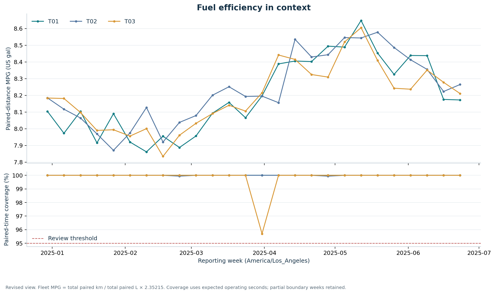

# Fleet fuel efficiency and price variance

**DA-E01 · Fuel and energy operations · Python, SQL, DuckDB, PostgreSQL, HTTP ingestion**

[繁體中文](README.zh-TW.md) · [Interactive report](outputs/dashboard.html) · [Analysis walkthrough](notebooks/01_fuel_analysis.ipynb) · [Metric definitions](docs/metrics.md) · [Runbook](docs/runbook.md)

Fuel purchased is not fuel consumed. This project combines vehicle counter observations, fuel-card transactions, tank movements, historical device assignments, and regional market prices to produce an auditable weekly fuel report. The report separates measurement gaps from efficiency changes and carries review candidates into investigation and follow-up records.

**Data scope:** January–June 2025; 3 fictional tenants, 30 vehicles, 36 devices, 45 drivers and 1,800 planned trips. Fleet operations and action records are synthetic. EIA prices are actual public observations, clearly separated from the fleet and restricted to retrospective context when historical availability is unknown.

## Start with the evidence



| Business question | Analysis and evidence |
| --- | --- |
| Has comparable fuel efficiency changed? | Matched fuel/distance intervals, usable coverage, same-vehicle/task history and eligible task peers |
| Why did purchasing expenditure change? | Consistent tax/discount treatment, refunds, a price–quantity bridge, and separately labelled regional price context |
| Does physical inventory support the consumption result? | Same-tank boundary measurements, movements, measurement uncertainty, and ECU comparison |
| Did a report lead to a measurable follow-up? | Review/adoption states, mature observation windows, coverage gates, and task-standardized descriptive comparisons |

The [interactive HTML report](outputs/dashboard.html) works offline after download. Filter one report view at a time, inspect vehicle/week evidence, and export the selected rows. GitHub's file viewer does not execute the dashboard; download it or serve the repository locally. The [notebook](notebooks/01_fuel_analysis.ipynb) follows the calculations in SQL, while the [Chinese chart guide](docs/chart_walkthrough_zh.md) explains what each figure can and cannot establish.

## Rebuild from a fresh checkout

Use Python 3.12 for the tested environment. Run these commands from the repository root:

```bash
python3.12 -m venv .venv
source .venv/bin/activate
python -m pip install -r requirements.lock.txt
python -m pip install --no-deps -e .
python -m fleet_fuel.cli run --profile full --operational snapshot
python -m pytest -q
```

The snapshot path regenerates the fictional world, serves its ELD events over a real local HTTP interface, ingests and validates them, loads the analytical database, calculates results, and writes the report and exports. Frozen EIA inputs support offline replay after dependencies are installed. The default run does not require an API key or PostgreSQL server.

For a shorter engineering check:

```bash
python -m fleet_fuel.cli run --profile smoke --operational snapshot --skip-report
```

The smoke profile observes a fixed 100-trip subset while retaining complete financial/inventory controls. Its intentionally sparse coverage does **not** reproduce the full-profile business results. Use a separate checkout or working copy to preserve a full run before switching profiles; a run replaces generated products in its target root.

The [runbook](docs/runbook.md) documents the stage commands, PostgreSQL mode, deliberate source refresh, notebook execution, recovery and output checks. The actual test log, quality report and manifests are the execution evidence; a configured workflow is not proof that its remote run succeeded.

## What is implemented

- A cursor-paginated local ELD source with snapshot-bound cursors, duplicate delivery, bounded retries, resume checkpoints and quarantine.
- A PostgreSQL operational adapter with atomic bootstrap, immutable source keys, a monotonic change cursor and repeatable-read extracts; an independently runnable snapshot mode.
- A versioned 26-table / 330-field contract with tenant keys, validity intervals, explicit missing states and record provenance.
- Counter segmentation, supported unit conversion, aligned fuel/distance denominators, as-of report versions and independent accounting controls.
- SQL analytical tables, Parquet exports, CSV evidence, a reusable DuckDB database, seven analytical figures, an offline dashboard and an executable notebook.
- Literal arithmetic examples, anomaly injections and integration fixtures; validation truth is isolated from analysis inputs.

The EIA integration is an official HTTPS **file download**, not an API call. The local event endpoint is a synthetic service used to exercise HTTP ingestion, not an actual ELD vendor connection. PostgreSQL service validation is tracked separately from snapshot execution; see [environment status](docs/runbook.md#execution-status).

## Three reporting views

| View | Information cutoff | Price context |
| --- | --- | --- |
| Initial | Week end + 48 hours | Simulated prices available by that cutoff |
| Revised | Week end + 7 days | Same historical availability rule; later operational corrections may enter |
| Retrospective | Latest retained source availability | Actual EIA historical observations retrieved in 2026 may enter |

Weekly windows use `America/Los_Angeles`, including daylight-saving boundaries; storage timestamps use UTC. Source values are selected **after** applying the cutoff. EIA observation dates are not fabricated historical publication times. Do not sum the three views together.

## Repository guide

| Location | Contents |
| --- | --- |
| `src/fleet_fuel/` | Generation, acquisition, HTTP ingestion, operational extraction, analysis, validation and reporting |
| `contracts/` | Versioned contract, SQL schema and filterable field dictionary |
| `config/` | Scenario settings, default seed and scope |
| `sql/analytics.sql` | Executable analytical definitions |
| `data/public/` | Frozen EIA source evidence, receipts and normalized public prices |
| `data/raw/`, `data/staged/` | Generated source files and accepted event records |
| `data/DA-E01.duckdb` | Rebuildable analytical database |
| `data/normalized/`, `data/derived/` | Columnar exports and canonical derived results |
| `outputs/` | Charts, dashboard, CSV results and structured report content |
| `validation/` | Independent fixtures, ingestion/build/quality evidence and requirement traceability |
| `docs/`, `notebooks/`, `tests/` | Explanations, executable exploration and reproducible checks |

Large reproducible database and raw products may be delivered outside Git source control. The generator, frozen public inputs, contracts and build entry point reconstruct them. Consult the release's delivery manifest for the exact packaged files; do not infer a completed upload from this directory guide.

## Interpretation and limitations

Fleet MPG is a ratio of summed eligible distance and fuel, not an average of vehicle MPG. Peer comparisons require comparable task, class, tenant, week and coverage. Price gaps are regional comparisons, not executable purchase offers. Inventory disagreement may reflect coverage, calibration or unknown movements. Before/after action differences remain descriptive even after task standardization; they do not establish causal savings or real customer adoption.

The exercise demonstrates reproducible engineering and analysis under explicit scenarios. It does not establish production signal calibration, actual fleet performance, or a vendor-certified J1939/OBD decoder. The [metric specification](docs/metrics.md), [simulation specification](docs/simulation.md), [source register](docs/sources.md), and [architecture decisions](docs/architecture.md) make these boundaries reviewable.

Code: [MIT](LICENSE). Original fictional sample data: [CC0 1.0](data/LICENSE.md). External EIA inputs retain source attribution and their own reuse conditions.
