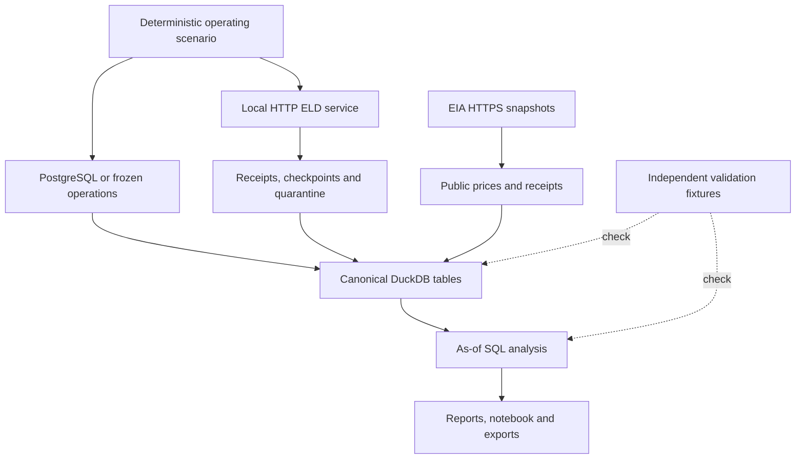

# Architecture and design decisions

DA-E01 uses one reproducible application package and one analytical database. Source-system behavior, source evidence, canonical data, analytical results and validation answers remain distinct. An operational PostgreSQL service is an optional runtime dependency for the database-source path; the complete snapshot path remains independently runnable.

## Data path

The HTTP source is a local simulation. EIA is an external official file-download source. PostgreSQL mode exercises a real operational database when a service is configured; snapshot mode identifies its source as `frozen_synthetic_snapshot`. Neither mode represents live company operations.

## Layers and ownership

| Layer | Main module / artifact | Responsibility |
| --- | --- | --- |
| Scenario | `simulation.py`, `config/simulation.json` | Entity histories, physical fuel/odometer progression, purchases and injected cases |
| Event service | `event_api.py` | Stable source snapshot, availability-ordered pagination and snapshot-bound cursors |
| Event intake | `ingestion.py` | Envelope checks, retries, deduplication, checkpoints, rejected records and normalized loading |
| Operational source | `operational.py` | Transactional source loading, immutable key enforcement, change cursor and consistent extract |
| Public acquisition | `sources.py` | Bounded downloads, immutable raw evidence, hashes, parsing and HTML/XLS comparison |
| Public normalization | `public_normalization.py` | Exact canonical types, tenant-scoped reference projection, actual availability and provenance |
| Canonical model | `contracts/da_e01_contract.json` | Stable table/field identity, meanings, keys, types and requirements |
| Analytics | `analysis.py`, `sql/analytics.sql` | Reporting windows, available source versions, paired intervals, purchasing, inventory and follow-up |
| Quality | `quality.py`, `tests/`, `validation/expected/` | Schema/field checks, independent examples, invariants and traceability |
| Presentation | `reporting.py`, `outputs/`, `notebooks/` | Visuals and explanatory outputs from calculated tables |

The contract contains 22 source/master/review/reference tables and four derived tables: `fuel_report_run`, `fuel_paired_interval`, `fuel_weekly_metric` and `fuel_inventory_balance`. Operational route/driver/trip files support the shared world; they do not expand this project's canonical 26-table contract.

## Identity and time

Tenant IDs are part of analytical ownership and relationship checks. A vehicle–device relationship has a business-valid interval and a knowledge-time boundary. A late correction can change the revised report without retroactively changing the initial view. Overlapping or absent assignment evidence yields an unresolved attribution, not a guessed vehicle.

`event_time` describes the observed event; `available_time` describes when that source version can be used; `retrieved_at` records source retrieval; validity intervals describe business history. UTC timestamps preserve instants, while reporting boundaries use `America/Los_Angeles`. Date-only public observations retain a date; unknown publication time stays null with an explicit unknown state.

The public adapter retains 62 regional observations. Canonical normalization creates 62 tenant-scoped references for each of three tenants because the approved contract requires tenant ownership. Those 186 rows still represent **62 observations**, not 186 independent prices. Their source keys and raw hashes preserve that distinction.

## Important decisions

| Decision | Reason and consequence |
| --- | --- |
| DuckDB for analytics; PostgreSQL for the operational path | Analytical rebuilds are portable while transactional extraction can be tested against a real source service. PostgreSQL success requires its own runtime evidence. |
| Files plus databases | JSONL retains event/source structure; Parquet supports typed interchange; CSV supports review; the database supports joins, constraints and reproducible SQL. A CSV is not the entire workflow. |
| Physical generator before source serialization | Fuel consumption, purchases, movements and tank inventory come from one consistent scenario. Tables are not independently randomized and joined later. |
| Cumulative counter intervals | Differences use compatible endpoints and signal definitions; reset, rollover, unknown unit and assignment problems remain explicit. |
| Purchase quantity is not consumed quantity | Financial analysis uses comparable transactions; efficiency uses measured fuel and distance; inventory has its own physical boundaries. |
| Three report views | Initial, revised and retrospective outputs preserve temporal meaning and prevent future-source leakage. |
| Frozen public snapshot | Rebuilds do not silently replace historical evidence with a refreshed page. Deliberate refresh writes a new snapshot. |
| Regional EIA context only | The ex-California West Coast reference is a regional proxy for NV/AZ scenario purchases, not an NV/AZ state observation. |
| Separate validation truth | The physical ledger and literal expected cases are not available to analytical calculations. They check conservation and edge behavior independently. |
| Inspectable SQL and evidence exports | Every figure can be traced to output IDs, contributing intervals, cutoff, version and source evidence. |

## Intake and database reliability

The HTTP intake stores delivery receipts in SQLite separately from the analytical database. Source identity plus revision controls duplicate acceptance. Snapshot-bound cursors cannot silently resume against another generated source version. Invalid envelopes and unsupported data enter quarantine with a reason. A checkpoint is useful for resuming delivery; it does not convert a rejected event into an accepted record.

The PostgreSQL bootstrap uses one transaction and a serialized writer. A repeated identical release is safe; reusing a technical key with different content is rejected. The change log and typed tables must agree. Extracts run as read-only repeatable-read transactions, publish only complete directories and preserve their change watermark. This is an application change log, not PostgreSQL WAL-based CDC.

DuckDB builds write a temporary database and replace the target after successful loading. Public normalization inserts prices and provenance in one transaction and is idempotent. Analytical code retains intermediate tables for inspection; validation must run after analysis to cover the derived tables too.

## Validation boundaries

The tests combine hand-calculated arithmetic, generated-world invariants, real HTTP requests, production SQL fixtures and public snapshot checks. PostgreSQL tests require a real service DSN; a skipped service test is not a pass. Reports and notebooks read calculated outputs, not hidden ground truth. Review thresholds are explicit business rules, not a trained anomaly model.

Current operating-environment limits and the authoritative execution files are listed in the [runbook](runbook.md#execution-status). Source terms are in [sources.md](sources.md) and [data/LICENSE.md](../data/LICENSE.md).
