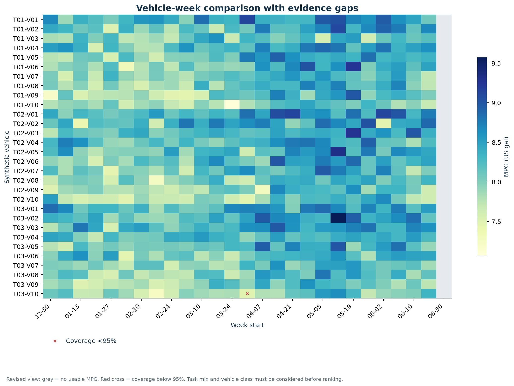
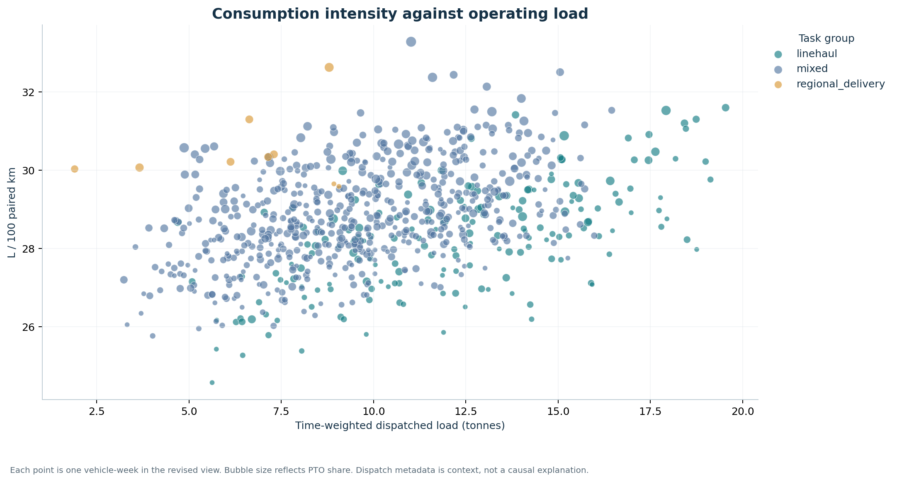
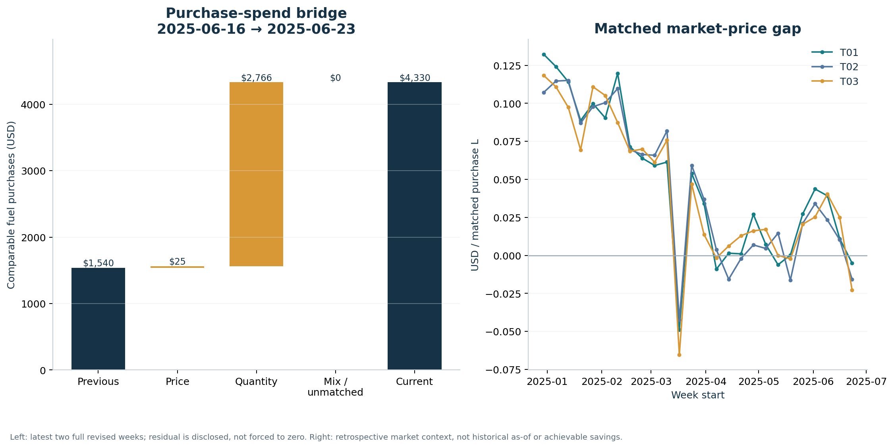
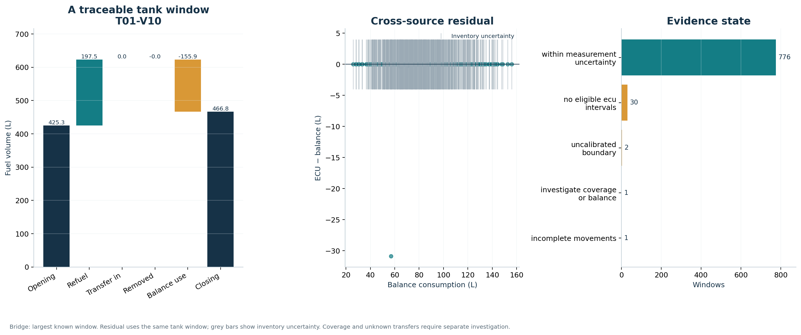
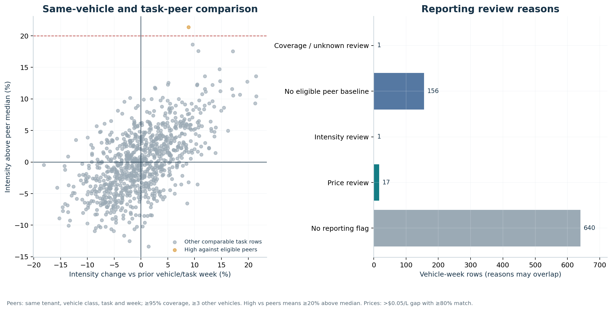
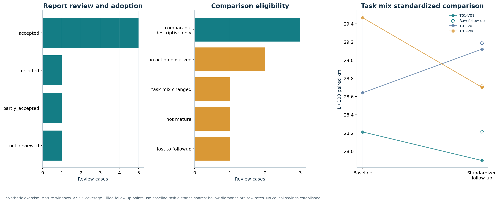

# DA-E01 圖表講解與分析重點

資料性質：合成車隊營運資料；公開 EIA 價格只作符合口徑的事後背景。

## 開場說明

這個專案先把購油、ECU 耗用與油箱存量分開，再在共同有效區間比較效率。本版涵蓋 3 個合成租戶與 30 輛車，修訂版車隊效率為 8.21 MPG，配對時間覆蓋率為 99.9%。這些數值只代表本次模擬資料。

## 1. Efficiency and usable observation coverage

效率與覆蓋率一起閱讀；低覆蓋週不可只憑 MPG 排名，車隊數值採總量比。

有量測的租戶週 MPG 範圍為 7.83–8.65；配對時間覆蓋率範圍為 95.7%–100.0%。不同工況尚未調整，不能直接當排名。

計算與限制：Revised view. Fleet MPG = total paired km / total paired L × 2.35215. Coverage uses expected operating seconds; partial boundary weeks retained.

口述時先指出問題與分母，再說明圖中的差異、資料可信度及下一個可行查核。不要將旗標描述成已驗證原因。

## 2. Vehicle-week efficiency matrix

橫向辨識同車變化，縱向比較前先核對任務與覆蓋；灰格代表未知，不是零效率。

矩陣共有 30 輛車、27 週；30 格沒有可用 MPG，1 格配對時間覆蓋低於 95%。

計算與限制：Revised view; grey = no usable MPG. Red cross = coverage below 95%. Task mix and vehicle class must be considered before ranking.

口述時先指出問題與分母，再說明圖中的差異、資料可信度及下一個可行查核。不要將旗標描述成已驗證原因。

## 3. Operating context and consumption

較高載重與 PTO 可能伴隨較高耗用；此圖用來選擇可比情境，不能將相關性當成浪費原因。

linehaul：179 筆車輛週的耗用強度中位數為 28.31 L/100km。這是各組描述性數值，仍須核對載重與 PTO 差異。
mixed：592 筆車輛週的耗用強度中位數為 28.75 L/100km。這是各組描述性數值，仍須核對載重與 PTO 差異。
regional_delivery：9 筆車輛週的耗用強度中位數為 30.21 L/100km。這是各組描述性數值，仍須核對載重與 PTO 差異。

計算與限制：Each point is one vehicle-week in the revised view. Bubble size reflects PTO share. Dispatch metadata is context, not a causal explanation.

口述時先指出問題與分母，再說明圖中的差異、資料可信度及下一個可行查核。不要將旗標描述成已驗證原因。

## 4. Price, quantity and market background

先拆解價格與購油量，再檢查未能分解的組合差異；市場差額僅供調查，不是可實現節省。

2025-06-16 至 2025-06-23 的可比購油淨額由 US$1,539.67 變為 US$4,330.44；價格效果 US$24.59、數量效果 US$2,766.18、未分解差額 US$0.00。

計算與限制：Left: latest two full revised weeks; residual is disclosed, not forced to zero. Right: retrospective market context, not historical as-of or achievable savings.

口述時先指出問題與分母，再說明圖中的差異、資料可信度及下一個可行查核。不要將旗標描述成已驗證原因。

## 5. Inventory reconciliation and uncertainty

橋接圖說明單一窗口的燃料守恆；中圖比對相同窗口的 ECU 與油箱平衡量，並保留量測不確定範圍。差額仍可能來自覆蓋或移動缺口，不能直接判為偷油。

within_measurement_uncertainty：776 個庫存窗口。
no_eligible_ecu_intervals：30 個庫存窗口。
uncalibrated_boundary：2 個庫存窗口。
incomplete_movements：1 個庫存窗口。
investigate_coverage_or_balance：1 個庫存窗口。

計算與限制：Bridge: largest known window. Residual uses the same tank window; grey bars show inventory uncertainty. Coverage and unknown transfers require separate investigation.

口述時先指出問題與分母，再說明圖中的差異、資料可信度及下一個可行查核。不要將旗標描述成已驗證原因。

## 6. Review priorities and confidence

先確認資料品質，再調查同任務耗用偏高與價格差異；旗標不是故障、舞弊或浪費的結論。

覆蓋查核 1 筆、任務內強度查核 1 筆、價格查核 17 筆。類別可重疊；未知覆蓋另留於明細。

計算與限制：Peers: same tenant, vehicle class, task and week; ≥95% coverage, ≥3 other vehicles. High vs peers means ≥20% above median. Prices: >$0.05/L gap with ≥80% match.

口述時先指出問題與分母，再說明圖中的差異、資料可信度及下一個可行查核。不要將旗標描述成已驗證原因。

## 7. From report to investigation and follow-up

先區分採用、成熟度與可比性，再用基準期各任務的里程占比加權後續耗用強度，降低任務組合不同的影響。原始與標準化差異均可回查；仍不能將變化當作措施的因果效果。

comparable_descriptive_only：3 筆審閱案例。
no_action_observed：2 筆審閱案例。
task_mix_changed：1 筆審閱案例。
lost_to_followup：1 筆審閱案例。
not_mature：1 筆審閱案例。
T01-V01 的 T01-V01-REVIEW-01：基準 28.21、原始後續 28.21、按基準任務組合標準化後續 27.90 L/100km；標準化差異 -0.31，任務里程占比最大變動 16.24 個百分點。僅為合成情境的描述性比較。
T01-V02 的 T01-V02-REVIEW-02：基準 28.64、原始後續 29.19、按基準任務組合標準化後續 29.12 L/100km；標準化差異 +0.48，任務里程占比最大變動 3.37 個百分點。僅為合成情境的描述性比較。
T01-V08 的 T01-V08-REVIEW-08：基準 29.46、原始後續 28.71、按基準任務組合標準化後續 28.70 L/100km；標準化差異 -0.76，任務里程占比最大變動 3.92 個百分點。僅為合成情境的描述性比較。

計算與限制：Synthetic exercise. Mature windows, ≥95% coverage. Filled follow-up points use baseline task distance shares; hollow diamonds are raw rates. No causal savings established.

口述時先指出問題與分母，再說明圖中的差異、資料可信度及下一個可行查核。不要將旗標描述成已驗證原因。

## 互動操作

開啟 `outputs/dashboard.html`，切換單一報告版本，再篩選租戶、車輛、週與覆蓋狀態。下載選取明細後，利用 output_id 與原資料庫中的報告版本回查。庫存依窗口篩選；措施圖依租戶與車輛顯示全期案例，圖中有明示。

## 面試說明重點

- 為什麼不能把購油量直接當耗用？油箱存量、移動與交易跨期會使兩者不同。
- 為什麼車隊 MPG 不平均各車 MPG？比率平均會讓不同里程與耗油量得到錯誤權重。
- 為什麼保留三種版本？初版與修訂版重現當時可知資訊，事後背景則明示新增的歷史資料。
- 為什麼沒有宣稱節省？目前只有合成演練，前後變化也可能來自任務或資料覆蓋差異。
